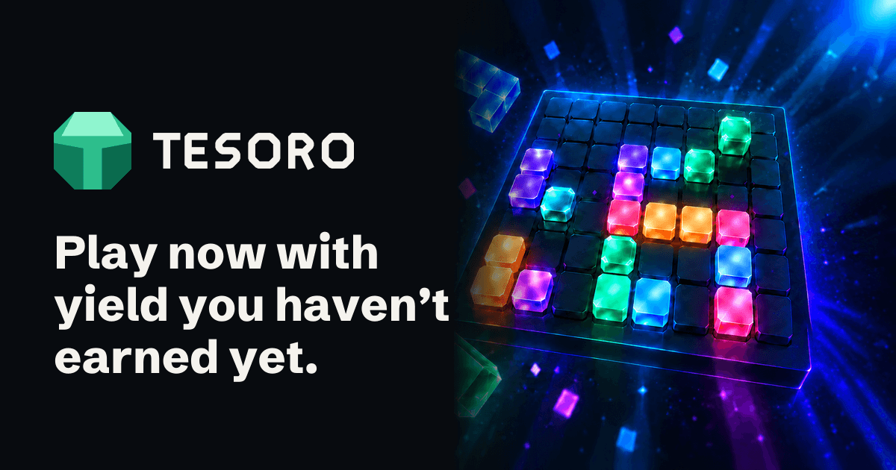
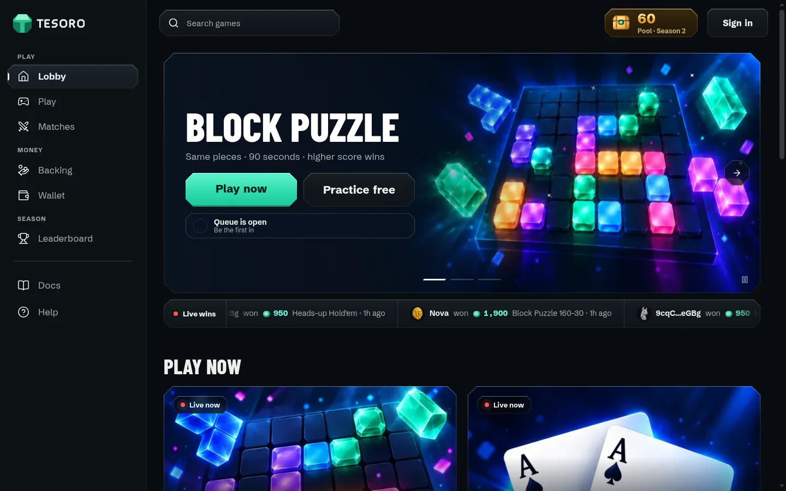
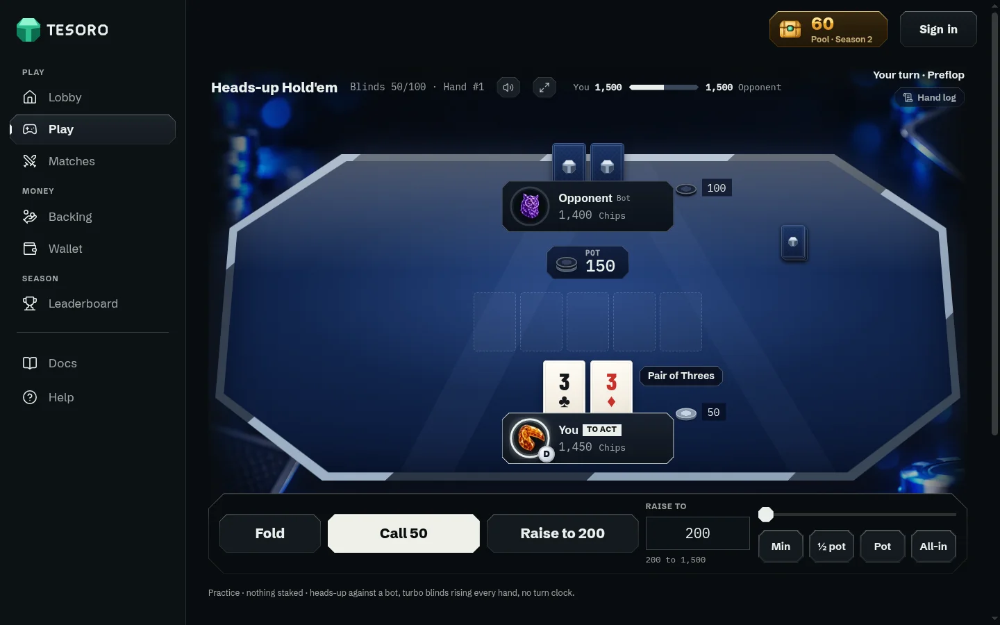
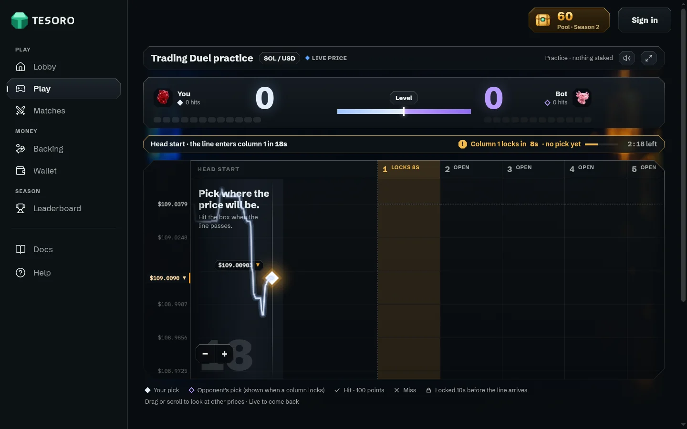

<p align="center">
  <a href="https://www.playtesoro.com"></a>
</p>

<p align="center">
  <a href="https://www.playtesoro.com"></a>
  <a href="LICENSE"></a>
  
  
  
  
  
</p>

**Tesoro lets stakers play head-to-head skill games with their future staking yield.** Lock SOL, ETH or HYPE, take an Advance on the yield it will earn, and play with it today. Your Principal is never played.

> **Testnets only.** Solana devnet, Ethereum Hoodi and HyperEVM testnet. Yield is **simulated** (1 month ≈ 10 minutes) and nothing has value.

## How it works

1. **Lock a Position.** A SOL, ETH or HYPE liquid staking token, for a 1–12 month Horizon.
2. **Take an Advance.** 80% of the Position's projected yield, paid now as **Gemas** ($0.01 each at issuance).
3. **Play Matches.** Win your opponent's Gemas in Block Puzzle, heads-up Hold'em or Trading Duel.
4. **Yield settles everything.** Accrued yield repays your Advance automatically. Winners Redeem Gemas as the loser's yield lands, or Instant Redeem them now for 75%.

Tesoro earns a Platform Fee on Matches, a 20% Yield Fee and the Instant Redeem Fee. Nothing is ever charged on Principal. The full rules are in the app's [Docs](https://www.playtesoro.com/docs).

<table>
  <tr>
    <td colspan="2"></td>
  </tr>
  <tr>
    <td width="50%"></td>
    <td width="50%"></td>
  </tr>
</table>

## Architecture

| Piece | What it does |
|---|---|
| `tesoro_core` (Solana) | The ledger: Positions, Advances, Gemas, Matches, fees, Leaderboard |
| `block_puzzle`, `holdem`, `trading_duel` | Game programs. Matches run in a **MagicBlock Private Ephemeral Rollup** (TEE), so cards, seeds and moves stay private until settlement |
| `tesoro_bridge` + EVM vaults | ETH (Hoodi) and HYPE (HyperEVM) Positions carried to the Solana ledger over **LayerZero V2** |
| `sim_lst`, `SimLST` | Simulated liquid staking tokens for the testnets |
| `app/` | Next.js 16 web app with Privy sign-in |
| `keeper/` | Writes prices, cranks yield, relays bridge messages, settles stalled Matches, pays Seasons |

Program IDs and contract addresses: [`docs/addresses.md`](docs/addresses.md).

## Quick start

Requires Node 22 and pnpm 10.

```bash
pnpm install
NEXT_PUBLIC_DEV_WALLET=1 pnpm dev   # http://localhost:3000, with a dev-only local wallet
```

It talks to the live devnet deployment, so no configuration is needed. Open `/lobby?dev=alice` and `/lobby?dev=bob` in two windows to play yourself. Optional settings are listed in [`app/.env.example`](app/.env.example).

<details>
<summary><b>Programs, contracts, keeper and checks</b></summary>

Programs need Rust 1.91.1 (pinned), Anchor 0.31.1 and Solana platform tools v1.54. Contracts need Foundry.

```bash
pnpm build:programs                       # plain `anchor build` fails; this pins platform tools v1.54
cargo test --workspace

pnpm build:contracts && pnpm test:contracts

pnpm --filter @tesoro/keeper start --once --dry-run
pnpm --filter @tesoro/keeper test

pnpm build:app
pnpm --filter @tesoro/app exec tsc --noEmit
pnpm --filter @tesoro/app exec eslint src
pnpm --filter @tesoro/app test
pnpm --filter @tesoro/app storybook       # every screen on fixtures, http://localhost:6006
```

The bridge is its own Anchor workspace: `cd bridge && anchor build --no-idl -- --tools-version v1.54`. Keeper jobs and keys: [`keeper/README.md`](keeper/README.md).

</details>

## Repo layout

```
programs/    Anchor workspace: tesoro_core, block_puzzle, holdem, trading_duel, sim_lst
bridge/      tesoro_bridge (LayerZero V2 OApp) and wiring scripts
contracts/   Foundry: PositionVaultOApp, SimLST, WstETHRateAdapter
app/         Next.js 16 web app
keeper/      off-chain cranks
docs/        ADRs, design notes, deployments
```

## Learn more

- [`CONTEXT.md`](CONTEXT.md): the glossary. Its terms are used verbatim in code and UI.
- [`docs/adr/`](docs/adr/): the decisions behind the design.
- [`docs/tesoro-core.md`](docs/tesoro-core.md), [`docs/cross-chain.md`](docs/cross-chain.md), [`docs/yield-model.md`](docs/yield-model.md), [`docs/games/`](docs/games/).
- [`docs/deployments.md`](docs/deployments.md): every deploy and smoke test, with signatures.
- [`SECURITY.md`](SECURITY.md): reviews, known risks and how to report an issue.

## Team

Built by [Gemstone Labs](https://github.com/Gemstone-Labs): Lawrence (CEO) and Ailton (CTO).

## License

[Apache License 2.0](LICENSE)
